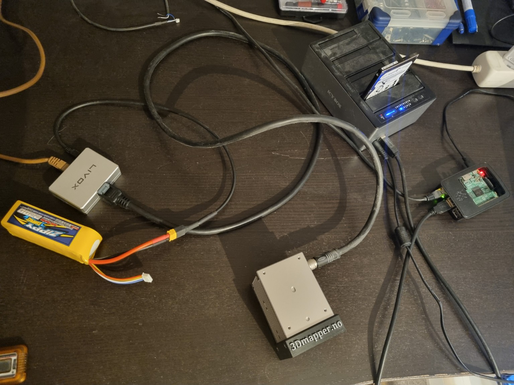
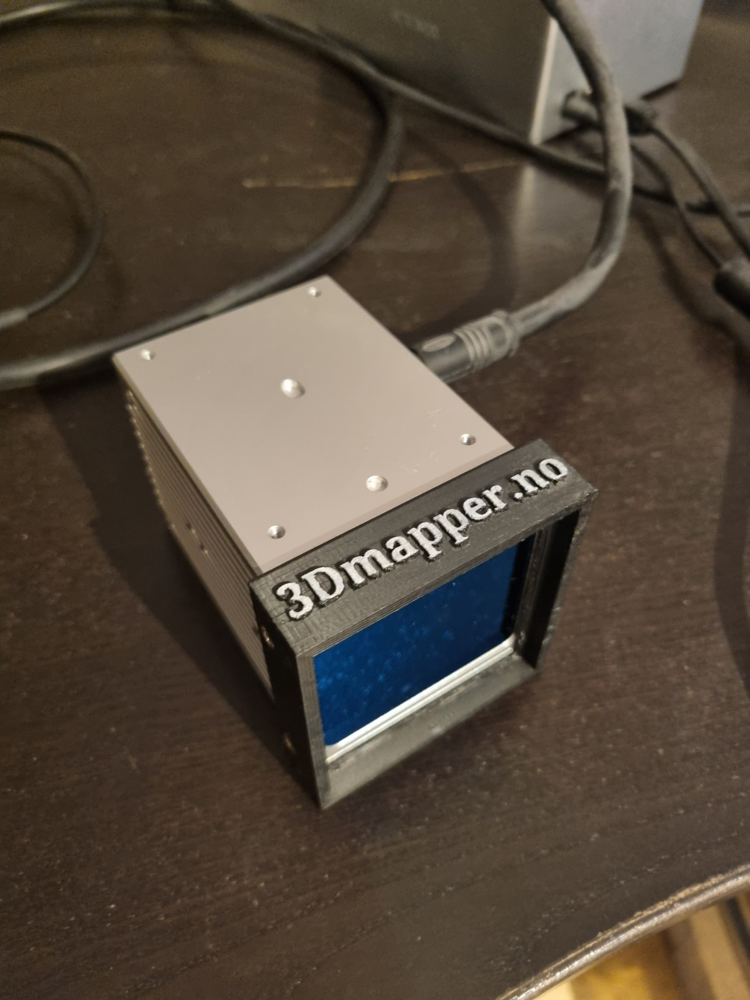
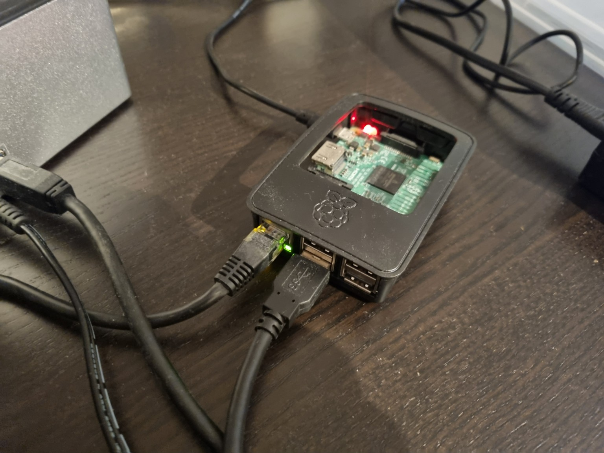
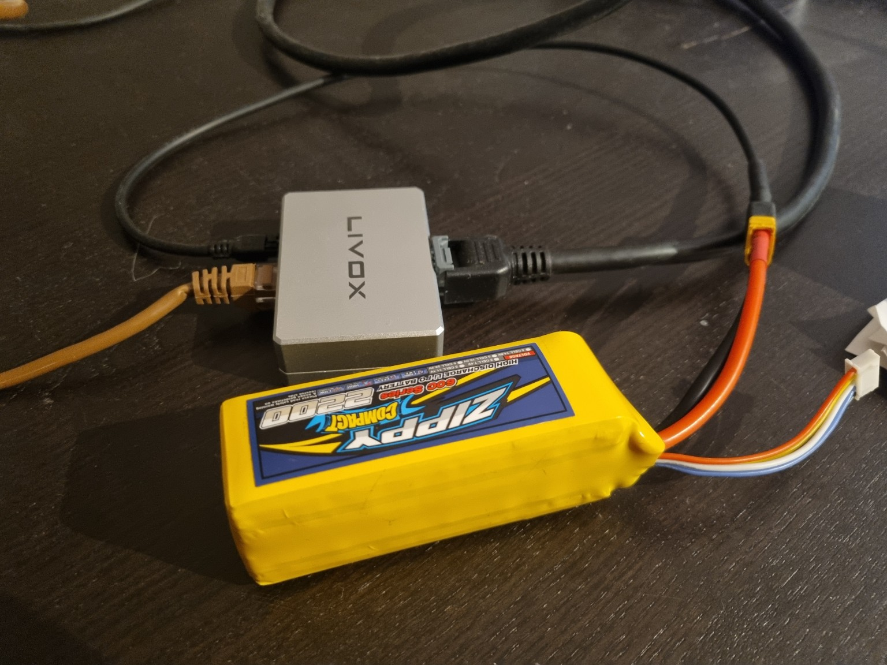

# Hardware test setup

Current bench setup used for the Livox Avia field logger and the next offline FAST-LIO stage.

## Current components

### Livox Avia

- Livox Avia solid-state LiDAR
- Internal Avia IMU used by the current logger
- LiDAR and IMU are recorded as ROS 2 topics for offline processing

### Raspberry Pi 3 Model B+

- Raspberry Pi 3 Model B+
- Ubuntu Server 22.04
- ROS 2 Humble
- Runs the Livox driver, live monitor and field recorder
- FAST-LIO is planned for offline processing on a stronger computer

### Livox interface and bench power

The current bench setup uses the Livox interface/power connection together with a temporary LiPo power source.

### Storage

The Raspberry Pi records directly to the external 2.5-inch drive shown in the overview image.

## Planned next stages

1. Offline FAST-LIO processing of recorded Livox Avia LiDAR + internal IMU data.
2. OpenRTK330LI integration after the local FAST-LIO pipeline is stable.
3. GNSS/RTK/INS timing and global georeferencing.
